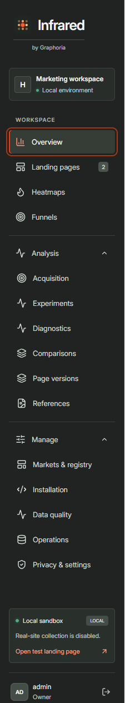
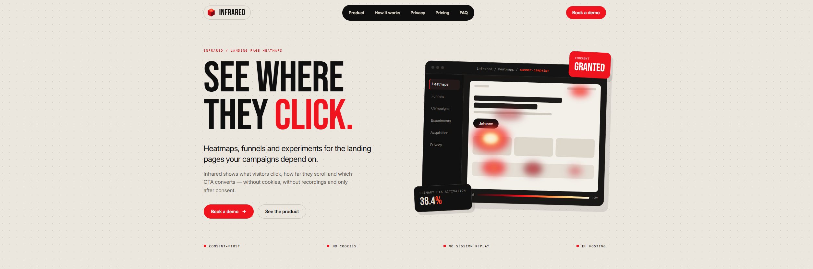
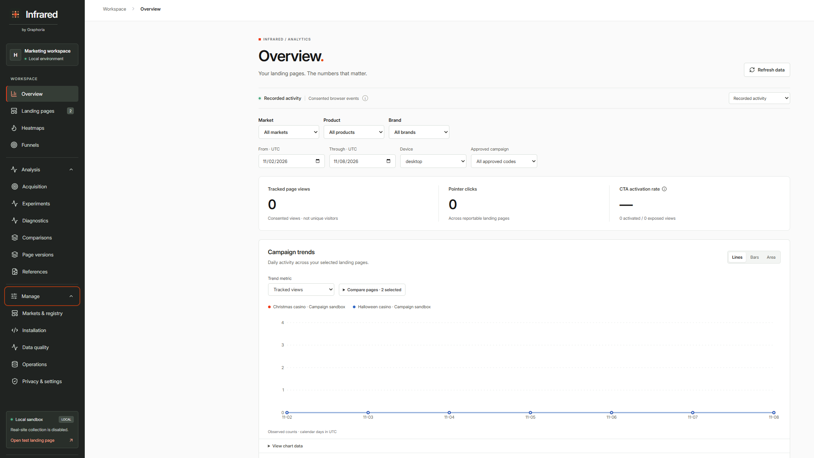
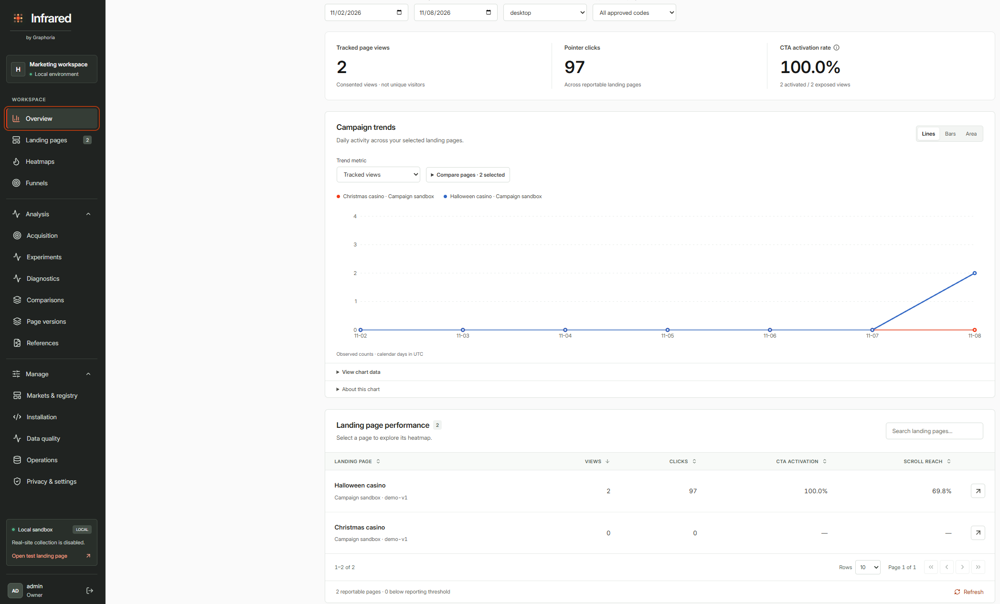
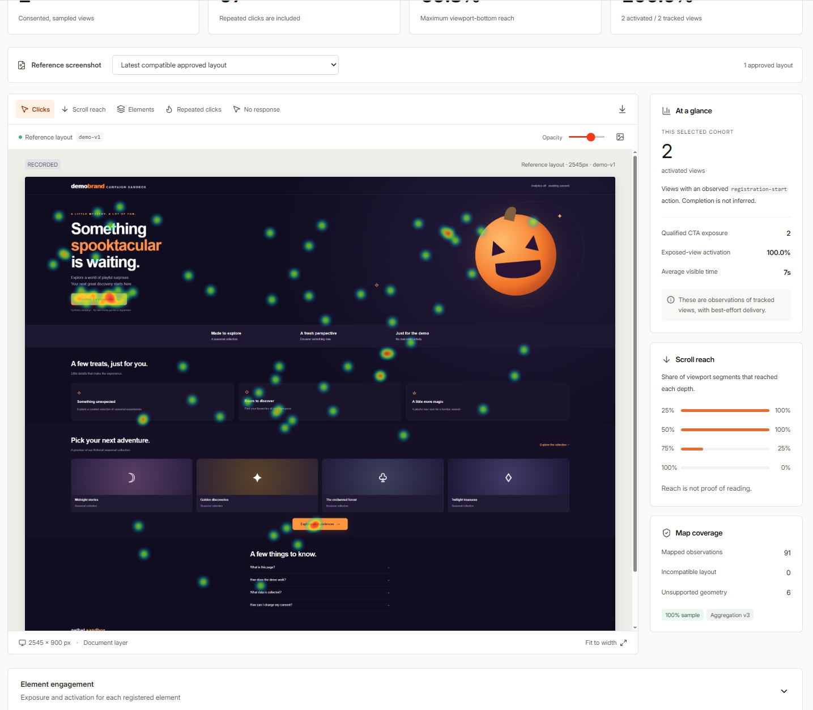
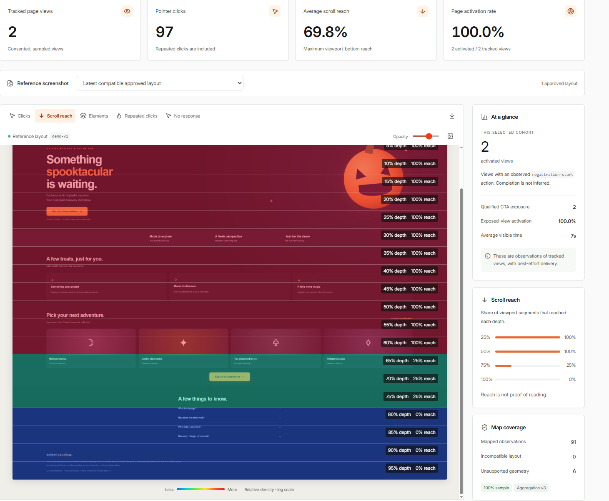
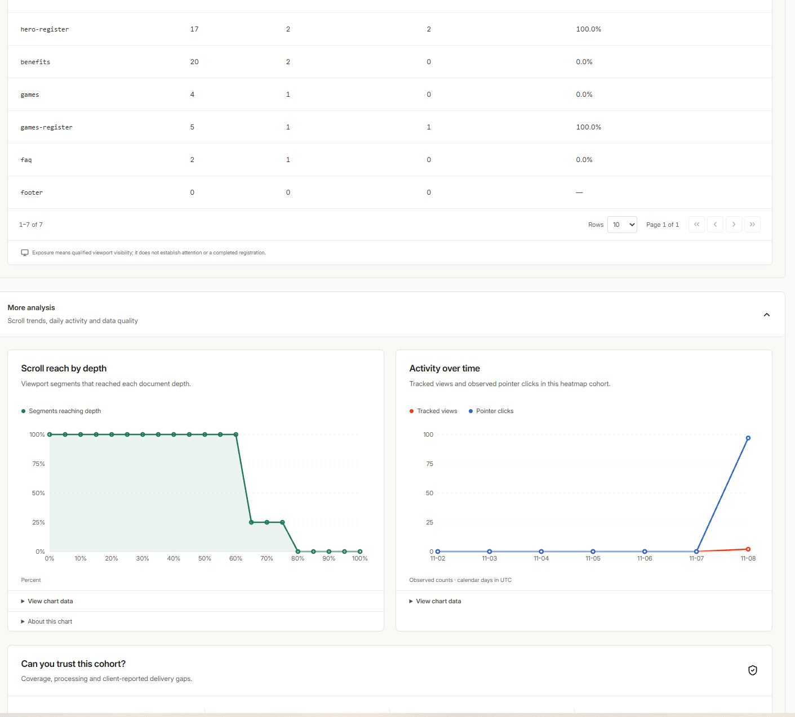
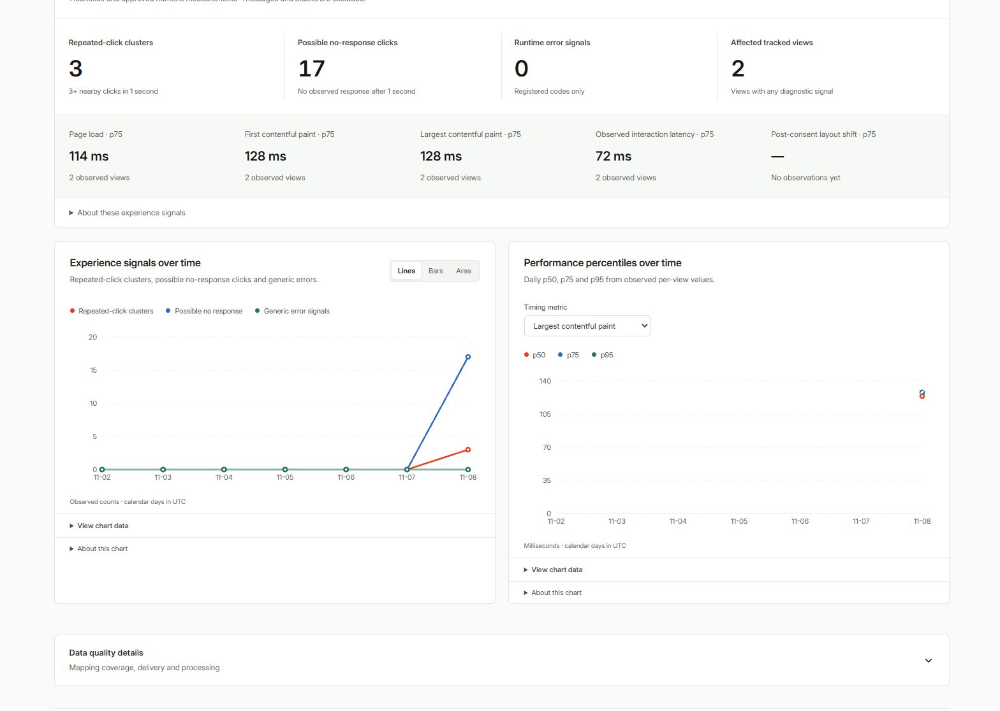

# Infrared


Infrared is a private workspace for consent-based heatmaps and conversion analytics. Use it to see where visitors click, how far they scroll, which calls to action they use, and where interactions may need investigation. The local release includes two fictional campaign pages, a tracking SDK, a collector, a worker, and a dashboard.

[Quick start](#quick-start) · [Dashboard navigation](#dashboard-navigation) · [Screenshot walkthrough](#screenshot-walkthrough) · [Development and operations](#development-and-operations)

## Quick start

Use Node.js 24 or later and the pnpm version pinned in [package.json](package.json). From the repository root:

```sh
pnpm install --frozen-lockfile
pnpm build
pnpm admin bootstrap-local
pnpm start
```

1. Open the [local dashboard](http://127.0.0.1:3000/) and sign in as `admin@local.test`. First-time bootstrap creates a random password in the Git-ignored `.local/admin-credentials.json` file. If you already have an administrator, sign in with that account.
2. Open the [Halloween demo](http://127.0.0.1:4173/casino/?lp=halloween), choose **Allow demo analytics**, and wait for **Recording clicks**. Click a CTA, scroll through the page, and note the viewport width in the demo header. The [Christmas demo](http://127.0.0.1:4173/casino/?lp=christmas) has its own report.
3. In **Heatmaps**, select **Halloween casino**, **Recorded activity**, and the recorded viewport width. The visible heatmap refreshes every few seconds. The date range uses UTC.
4. If the clicks appear in the count but the overlay has no matching reference, install Chromium with `pnpm exec playwright install chromium` if needed. Select **Add a reference layout**, capture the recorded width, review the full image, approve it, and select **Use this layout**. The example below used a 2545 px viewport.

If Git Bash cannot find pnpm and the dependencies are already installed, run the equivalent startup commands:

```sh
npm run build
node --import tsx scripts/admin.ts bootstrap-local
npm start
```

The administrator command requires the local server to be stopped. Leave the startup terminal open while using the dashboard. If the browser reports a refused connection, check that the terminal shows Infrared listening on port 3000.

| Local service | Purpose |
| --- | --- |
| [Dashboard · 3000](http://127.0.0.1:3000/) | Private workspace and management API |
| [Demo · 4173](http://127.0.0.1:4173/casino/?lp=halloween) | Fictional campaign pages and the local experiment lab |
| [Collector health · 8080](http://127.0.0.1:8080/healthz) | SDK assets, collection configuration, event ingestion, and health |

### Data sources

- **Recorded activity** shows consented browser observations, including your own demo clicks. Tracked views are page views and may include multiple views from the same person.
- **Generated samples** shows fixture traffic. To populate it, stop the native server, run `pnpm seed`, and restart. The command generates 210 views across Halloween and Christmas and skips a fixture that has already been seeded.
- **Earlier data · unclassified** shows retained historical events whose source could not be separated reliably.

## Dashboard navigation

The sidebar groups daily work under **Workspace**, deeper reporting under **Analysis**, and configuration under **Manage**. The links below open each screen on the default local dashboard.

### Workspace

| Screen | Use it to |
| --- | --- |
| [Overview](http://127.0.0.1:3000/#campaigns) | Compare page views, pointer clicks, and CTA activation across campaigns. Filter by market, product, brand, dates, device, or approved campaign code and open a page from the performance table. |
| [Landing pages](http://127.0.0.1:3000/#pages) | Find a registered page, inspect its collection status and URL scope, or add a page. Open its heatmap from the list. The sidebar badge shows the page count. |
| [Heatmaps](http://127.0.0.1:3000/#heatmaps) | Inspect clicks, scroll reach, registered elements, repeated clicks, and possible no-response clicks on an approved screenshot. Use the map controls for opacity, reference visibility, and annotated PNG export. |
| [Funnels](http://127.0.0.1:3000/#funnels) | Follow tracked views through qualified primary CTA exposure and a later activation of that CTA. Inspect step counts, drop-off, and time to action. |

### Analysis

| Screen | Use it to |
| --- | --- |
| [Acquisition](http://127.0.0.1:3000/#acquisition) | Review backend-confirmed registrations and qualified acquisitions. Reconcile campaign spend and review cost per acquisition when outcome and spend coverage support it. |
| [Experiments](http://127.0.0.1:3000/#experiments) | Plan A/A or A/B tests, review assigned and rendered variants, check validity, and read results when the test criteria are met. Use the local lab to try the flow with fictional outcomes. |
| [Diagnostics](http://127.0.0.1:3000/#diagnostics) | Investigate repeated-click clusters, possible no-response clicks, generic error signals, and browser performance timings. |
| [Comparisons](http://127.0.0.1:3000/#compare) | Compare two landing pages over a shared reporting window using their trends and compatible reference heatmaps. |
| [Page versions](http://127.0.0.1:3000/#versions) | Compare observed cohorts for two revisions of the same page. Each revision keeps its own traffic and reference layout. |
| [References](http://127.0.0.1:3000/#references) | Capture a local fixture or import a screenshot and layout manifest. Review, approve, and select the reference that matches the viewport and revision. |

### Manage

| Screen | Use it to |
| --- | --- |
| [Markets & registry](http://127.0.0.1:3000/#markets) | Organize websites and pages by market, product, and brand. Review or import registry data and set reporting metadata such as currency. |
| [Installation](http://127.0.0.1:3000/#installation) | Review the page selector and installation status, check the integration, and find the SDK snippet, consent bridge, and setup instructions. |
| [Data quality](http://127.0.0.1:3000/#quality) | Check collection and processing health, including worker jobs, event counts, and collector rejections. |
| [Operations](http://127.0.0.1:3000/#operations) | Run or schedule retention and verified backups, inspect operation history and alerts, and monitor queue health. Available to owners. |
| [Privacy & settings](http://127.0.0.1:3000/#settings) | Review the privacy rules, set retention and the minimum reporting cohort, and use the global collection stop. |

The **Local sandbox** card opens the test landing page. The account area shows the signed-in role and includes the sign-out control.



## Screenshot walkthrough

The dashboard screenshots show the local Halloween example from November 8, 2026. Its metrics depend on the selected date range and recorded activity.

### 1. Product concept

The marketing mockup introduces the product. **Product** previews the analytics features, **How it works** describes the tracking flow, **Privacy** covers consent and data handling, **Pricing** and **FAQ** are buyer information, and **Book a demo** is the marketing CTA. The mockup's figures, navigation, and hosting copy are illustrative. The local analytics walkthrough starts in the dashboard below.



### 2. Overview before and after collection

Before recorded activity, the selected cohort shows zero views and clicks. The CTA rate displays a dash when there are zero qualifying exposures. Check the data source, dates, device, and campaign filters if you expected data.



After two consented Halloween views, Overview shows **97 pointer clicks** and **2 activations from 2 qualifying CTA exposures**. The resulting 100% is based on two exposures. The Christmas page has its own row and shows zero activity for this example. Use **Trend metric** to switch what the chart measures, **Compare pages** to choose series, and **Lines**, **Bars**, or **Area** to change the chart display.



### 3. Click heatmap

The **Clicks** layer places recorded clicks over the approved `demo-v1` reference at **2545 × 900 px**. Warmer spots show higher relative click density. **Map coverage** accounts for the difference between the total and the overlay. The example mapped **91 of 97 clicks** and excluded **6** with unsupported geometry.



| Heatmap layer | What it shows |
| --- | --- |
| **Clicks** | Relative density of mapped pointer clicks, including repeats. |
| **Scroll reach** | The share of compatible viewport segments whose visible bottom reached each page depth. |
| **Elements** | Registered element outlines and qualified exposure counts. Open **Element engagement** for click and activation details. |
| **Repeated clicks** | Locations linked to clusters of nearby clicks in a short time. |
| **No response** | Locations of clicks on interactive elements with no observed response within the detection window. Treat these as investigation leads. |

Document mapping needs the exact viewport width and a compatible document height. Registered-element mapping can align clicks within known elements across responsive layouts. Counts remain available for cohorts without an approved reference. See [heatmap and chart definitions](docs/ANALYTICS_UPGRADE.md#heatmaps-and-page-versions).

### 4. Scroll reach

The **Scroll reach** layer shows how far the visible viewport extended. In this example, **100%** of compatible segments reached 50% depth, **25%** reached 75% depth, and **0%** reached the bottom. The summary's **69.8%** is average maximum reach. Reading and attention are separate measures.



### 5. Element engagement and more analysis

**Element engagement** breaks activity down by registered element. In the example, `hero-register` had **17 clicks** across a cohort with **2 exposed views** and **2 activated views**. Repeated clicks count individually, while the exposure and activation columns count distinct views per element. Open **More analysis** for scroll depth, daily views and clicks, and data quality. **View chart data** opens the underlying values.



### 6. Diagnostics

The same example shows **3 repeated-click clusters**, **17 possible no-response clicks**, and **2 affected views**. The timing chart lets you switch metrics and inspect daily p50, p75, and p95. The example has a p75 largest contentful paint of **128 ms** from two observed views. A dash means a timing has no observations in the cohort.



## Development and operations

- **Local storage.** Native mode uses PGlite under `.local/database`. Run one native process against that directory. Stop it before offline administration, seeding, retention, backup, or restore. Use Ctrl+C for a graceful shutdown.
- **Reference capture.** With the server running, install Chromium with `pnpm exec playwright install chromium`. Then capture through **References**, or run `pnpm capture` for the four preconfigured Halloween and Christmas references at 1440 × 900 and 390 × 844. The CLI approves those deterministic fixtures. UI captures and manual imports require review.
- **Runtime.** `pnpm dev` builds and starts the local server. Rebuild and restart after editing source. If port 4173 is occupied, set both `DEMO_PORT` and `DEMO_ORIGIN` to a matching free port and loopback origin in the local `.env`.
- **Release scope.** The local demo collects only from fictional fixtures. The repo also includes a whole-site SDK and API with path rules, and owner approval and suspension endpoints for a configured production release. Deployment requirements are tracked in [Production readiness](docs/PRODUCTION_READINESS.md).
- **Privacy.** Analytics requires consent and eligible public context. The SDK uses memory-only tracking IDs and excludes private regions and form values. Workspace sign-in uses its own session. Real-data reporting applies a configurable minimum cohort size.

```sh
pnpm typecheck
pnpm test
pnpm build
pnpm release:check
pnpm run doctor
pnpm test:e2e
```

Browser tests use disposable loopback services and a separate database. Test screenshots go into `.local/evidence`.

### PostgreSQL with Docker Compose

The optional [Compose configuration](compose.yaml) runs the local demo against PostgreSQL. This path remains unverified on the implementation workstation. Copy `.env.example` to `.env` and set `POSTGRES_PASSWORD` before starting it.

```sh
docker compose --profile tools run --rm bootstrap
docker compose build
docker compose up -d db
docker compose run --rm app pnpm admin bootstrap-local
docker compose up -d app
docker compose exec app cat /app/.local/admin-credentials.json
```

The app publishes its ports on loopback, and PostgreSQL stays on the private Compose network. `docker compose down` preserves the named data volumes.

## Further reading

- [Architecture](docs/ARCHITECTURE.md) · [Data dictionary](docs/DATA_DICTIONARY.md) · [Chart controls and definitions](docs/CHARTS.md)
- [Marketing installation](docs/MARKETING_INSTALL.md) · [Installation checks](docs/INSTALLATION_CHECKS.md) · [Consent integration](docs/CONSENT_INTEGRATION.md)
- [Acquisition and experiments](docs/ACQUISITION_EXPERIMENTS.md) · [Analytics definitions](docs/ANALYTICS_UPGRADE.md)
- [Operations, retention, backup and recovery](docs/OPERATIONS.md) · [Threat model](docs/THREAT_MODEL.md) · [Security audit](docs/SECURITY_AUDIT.md)
- [Implementation history](docs/IMPLEMENTATION_STATUS.md) · [Production readiness](docs/PRODUCTION_READINESS.md) · [Production stack](docs/PRODUCTION_STACK.md) · [Dependency inventory](docs/DEPENDENCIES.md) · [Original specification](docs/INITIAL_BUILD_SPEC.md)
